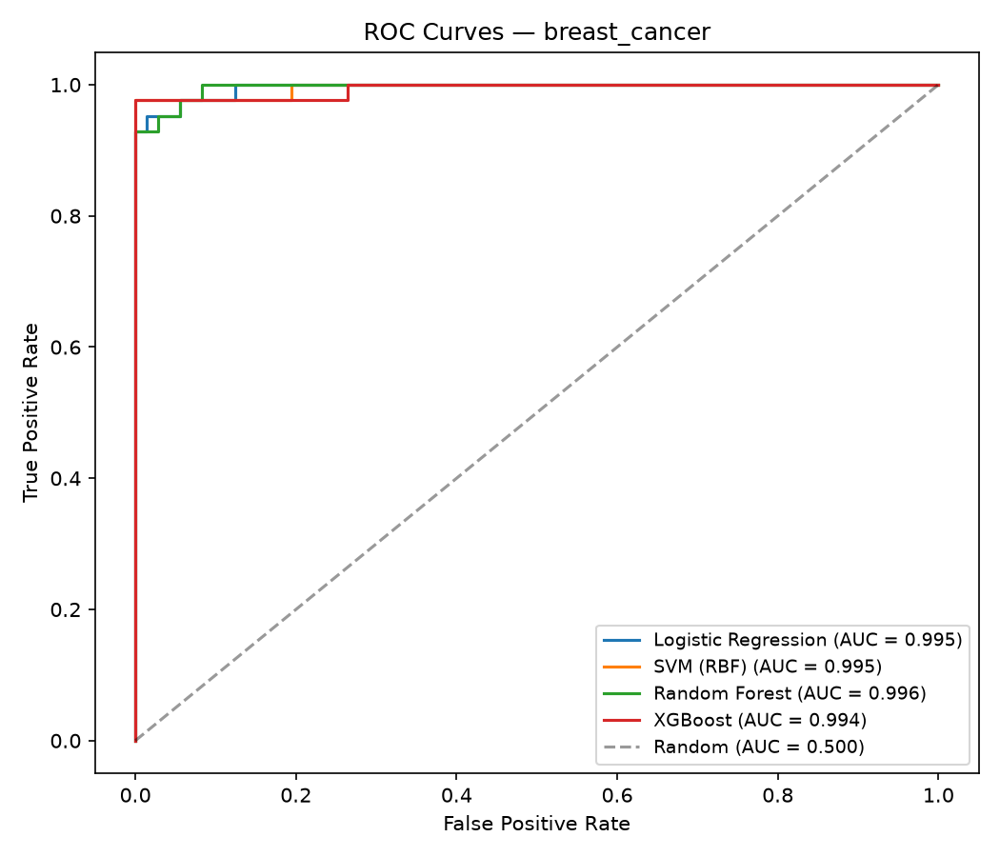
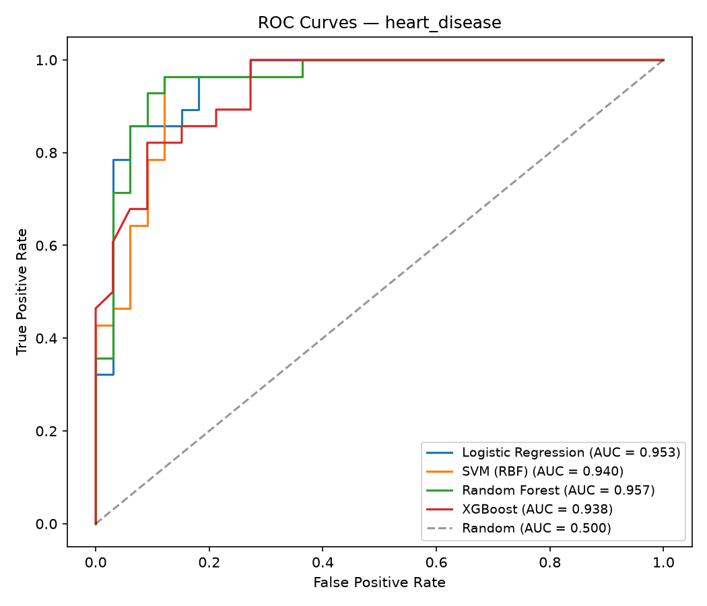
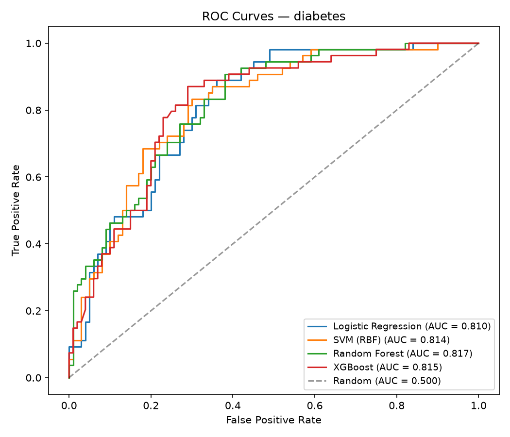
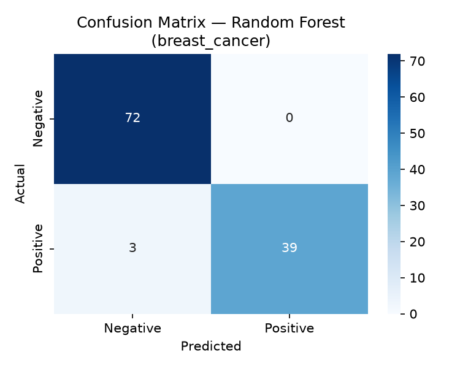
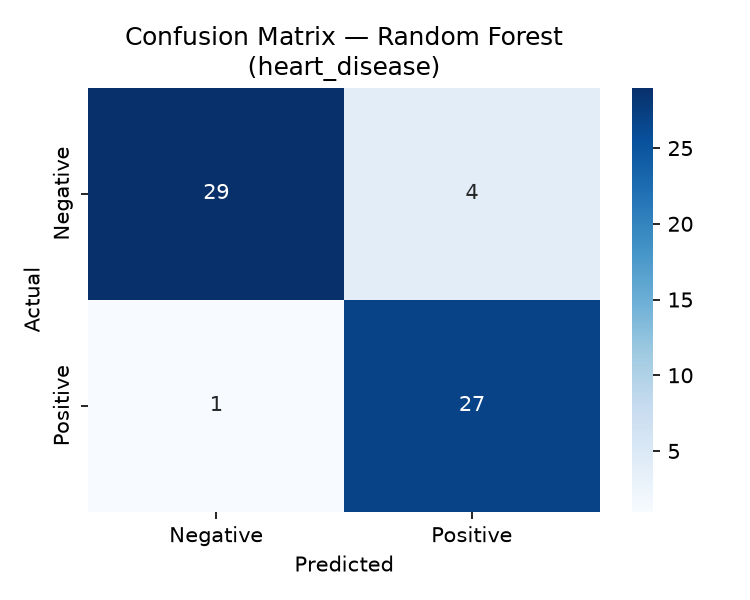
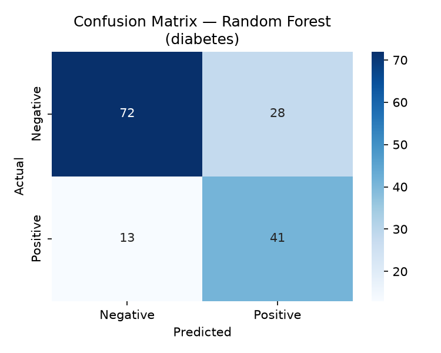
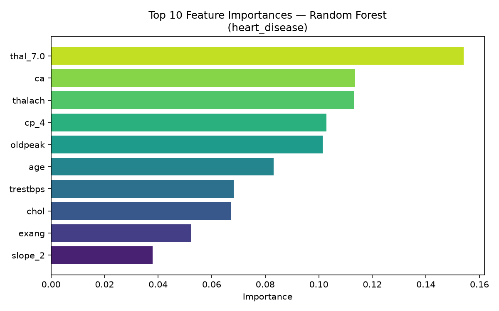
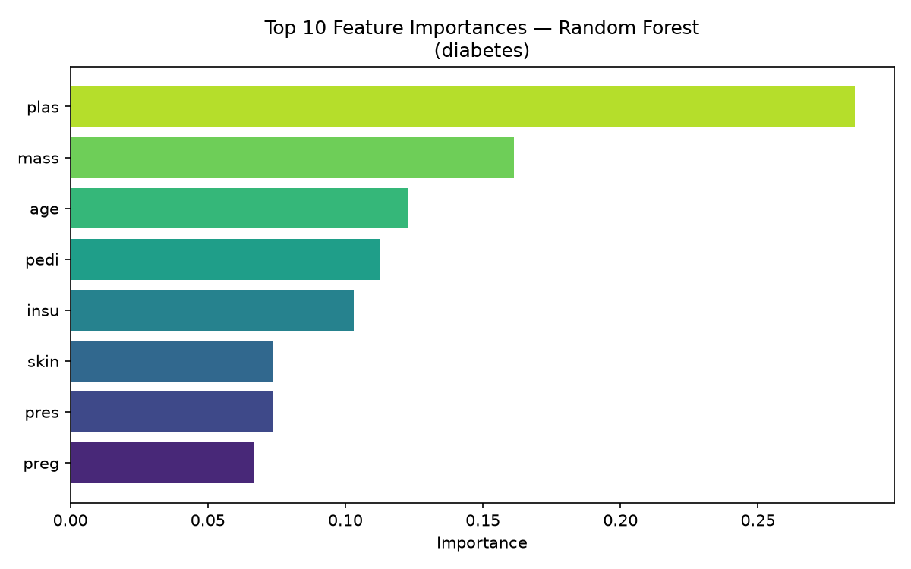

# 🩺 CodeAlpha_DiseasePrediction: Multi-Disease Clinical ML Pipeline

[](https://python.org)
[](https://scikit-learn.org/)
[](https://xgboost.readthedocs.io/)
[](https://streamlit.io/)
[](LICENSE)
[](https://codealpha.tech/)

**CodeAlpha_DiseasePrediction** is an end-to-end, reproducible machine learning pipeline designed to predict the likelihood of disease from structured patient clinical data across three medical domains: **Breast Cancer (Wisconsin)**, **Heart Disease (UCI Cleveland)**, and **Type 2 Diabetes (Pima Indians)**. Built as part of the CodeAlpha Machine Learning Internship (Task 4), the project implements a leak-free preprocessing workflow, 5-fold Stratified Cross-Validation, GridSearchCV hyperparameter tuning across four classifier families (Logistic Regression, RBF SVM, Random Forest, XGBoost), comprehensive diagnostic evaluation metrics, feature importance interpretation, and an interactive Streamlit clinical risk assessment web application.

---

## 📌 Problem Statement & Objective

Early detection of chronic and critical illnesses significantly improves patient survival rates and reduces healthcare costs. However, clinical datasets present distinct challenges:
- **Missing or biologically anomalous values** (e.g., zero glucose or blood pressure values in diabetes records representing missing observations).
- **Categorical encoding requirements** (e.g., fluoroscopy vessels, chest pain classification, ECG categories).
- **Class imbalance** where diseased patients represent a critical minority.
- **Asymmetric diagnostic risk**: A **false negative** (failing to identify an ill patient) is clinically catastrophic compared to a false positive (requiring confirmation through secondary testing).

### Core Objective
Engineer a unified, modular, and leak-free machine learning pipeline that ingests heterogeneous clinical datasets, optimizes classifiers for **ROC-AUC and Recall**, selects the most robust model per disease, and deploys the best estimators via serialized models and a Streamlit user interface.

---

## 📊 Datasets Covered

| # | Dataset | Source | Total Samples | Features | Target Variable | Positive Class Definition |
|---|---|---|---|---|---|---|
| **1** | **Breast Cancer Wisconsin** | `sklearn.datasets.load_breast_cancer` | 569 | 30 numeric | Malignant / Benign | `1` = Malignant (Tumor present) |
| **2** | **Heart Disease (Cleveland)** | UCI Machine Learning Repository (`ucimlrepo` / public CSV fallback) | 303 | 13 clinical (num + cat) | Diagnosis of heart disease | `1` = Angiographic disease (>50% diameter narrowing) |
| **3** | **Pima Indians Diabetes** | OpenML (`fetch_openml` / GitHub raw fallback) | 768 | 8 diagnostic numeric | Diabetes onset | `1` = Tested positive for diabetes |

*Note: All data ingestion scripts in `src/data_loader.py` include graceful fallback mechanisms to ensure the pipeline runs reliably offline or online.*

---

## 🛠️ Tech Stack

- **Core Language**: Python 3.10+
- **Data Engineering**: `pandas` (v2.2.2), `numpy` (v1.26.4)
- **Machine Learning**: `scikit-learn` (v1.5.1), `xgboost` (v2.1.1)
- **Model Serialization**: `joblib` (v1.4.2)
- **Visualization**: `matplotlib` (v3.9.2), `seaborn` (v0.13.2)
- **Web Application**: `streamlit` (v1.38.0)
- **Exploration & Research**: `jupyter`, `nbconvert`, `ipykernel`
- **Data Ingestion**: `ucimlrepo` (v0.0.7)

---

## 🔬 Methodology & Pipeline Architecture

The pipeline follows strict production ML standards to prevent target leakage and ensure clinical validity:

```
Raw Medical Data (sklearn / UCI / OpenML)
                   │
                   ▼
     [Exploratory Data Analysis]
     ├─ Distribution analysis & missingness audits
     ├─ Correlation heatmaps & class balance charts
                   │
                   ▼
     [Preprocessing & Imputation]
     ├─ Physiological zero-replacement (Pima Glucose, BP, Insulin, BMI -> NaN)
     ├─ UCI Cleveland missing marker handling ('?' -> NaN)
     ├─ Median imputation fitted without lookahead
     ├─ One-hot encoding for categorical factors (cp, restecg, slope, thal)
                   │
                   ▼
     [Stratified Train/Test Split (80/20)]
     ├─ random_state=42 with stratify=y
     ├─ StandardScaler fit STRICTLY on X_train, applied to X_test
     ├─ Class weighting: balanced penalty / scale_pos_weight
                   │
                   ▼
     [Model Training & 5-Fold Stratified CV]
     ├─ Logistic Regression, SVM (RBF), Random Forest, XGBoost
     ├─ GridSearchCV scoring on ROC-AUC with Recall tracking
                   │
                   ▼
     [Holistic Test Evaluation & Artifact Saving]
     ├─ Accuracy, Precision, Recall, F1-Score, ROC-AUC
     ├─ Confusion matrices, combined ROC curves, Top-10 Feature Importances
     ├─ Best estimators serialized to /models via joblib
                   │
                   ▼
     [Interactive Deployment]
     └─ Streamlit diagnostic web app (app.py) + standalone prediction CLI (src/predict.py)
```

### Why `class_weight='balanced'` over synthetic oversampling (SMOTE)?
In small medical datasets (such as 303 heart disease patients or 569 cancer patients), generating synthetic samples via KNN interpolation can introduce noise near complex non-linear decision boundaries and create subtle cross-fold leakage if not isolated within every fold. Applying cost-sensitive loss weighting (`class_weight='balanced'` in scikit-learn and `scale_pos_weight` in XGBoost) directly penalizes false negatives during loss calculation without synthesizing artificial patient records.

---

## 📈 Experimental Results (Real Benchmark Run)

All numbers below reflect the exact test-set evaluation after 5-fold stratified cross-validation and hyperparameter tuning on the fixed test partition (`test_size=0.2, random_state=42`).

### 1. Best Model Summary per Disease

| Dataset | Best Selected Model | Accuracy | Precision | Recall (Sensitivity) | F1-Score | ROC-AUC |
|---|---|---|---|---|---|---|
| **Breast Cancer (Wisconsin)** | **Random Forest** | **97.37%** | 100.00% | 92.86% | 0.9630 | **0.9960** |
| **Heart Disease (Cleveland)** | **Random Forest** | **91.80%** | 87.10% | **96.43%** | 0.9153 | **0.9567** |
| **Diabetes (Pima Indians)** | **Random Forest** | **73.38%** | 59.42% | **75.93%** | 0.6667 | **0.8172** |

> **Clinical Trade-Off Note:** In medical diagnosis, **Recall (Sensitivity)** is prioritized. A false negative means an ill patient is sent home without treatment, whereas a false positive leads to secondary validation tests. **Random Forest** achieved the best overall balance of ROC-AUC and high Recall across all three datasets, notably achieving **96.43% Recall** on Heart Disease.

---

### 2. Full Model Comparison Tables

#### A. Breast Cancer Wisconsin (Test n = 114)
| Model | Accuracy | Precision | Recall | F1-Score | ROC-AUC |
|---|---|---|---|---|---|
| **Random Forest** | 97.37% | 100.00% | 92.86% | 0.9630 | **0.9960** |
| **SVM (RBF)** | 98.25% | 97.62% | 97.62% | 0.9762 | 0.9954 |
| **Logistic Regression** | 97.37% | 97.56% | 95.24% | 0.9639 | 0.9954 |
| **XGBoost** | 96.49% | 100.00% | 90.48% | 0.9500 | 0.9937 |

#### B. Heart Disease Cleveland (Test n = 61)
| Model | Accuracy | Precision | Recall | F1-Score | ROC-AUC |
|---|---|---|---|---|---|
| **Random Forest** | **91.80%** | 87.10% | **96.43%** | 0.9153 | **0.9567** |
| **Logistic Regression** | 85.25% | 80.65% | 89.29% | 0.8475 | 0.9535 |
| **SVM (RBF)** | 91.80% | 87.10% | 96.43% | 0.9153 | 0.9405 |
| **XGBoost** | 83.61% | 82.14% | 82.14% | 0.8214 | 0.9378 |

#### C. Pima Indians Diabetes (Test n = 154)
| Model | Accuracy | Precision | Recall | F1-Score | ROC-AUC |
|---|---|---|---|---|---|
| **Random Forest** | 73.38% | 59.42% | 75.93% | 0.6667 | **0.8172** |
| **XGBoost** | 75.97% | 62.32% | 79.63% | 0.6992 | 0.8151 |
| **SVM (RBF)** | 72.73% | 59.09% | 72.22% | 0.6500 | 0.8139 |
| **Logistic Regression** | 70.78% | 57.14% | 66.67% | 0.6154 | 0.8104 |

---

### 3. Visualizations & Diagnostic Curves

#### ROC Curves Comparison
| Breast Cancer | Heart Disease | Pima Diabetes |
|:---:|:---:|:---:|
|  |  |  |

#### Confusion Matrices (Best Selected Estimator)
| Breast Cancer (Random Forest) | Heart Disease (Random Forest) | Diabetes (Random Forest) |
|:---:|:---:|:---:|
|  |  |  |

#### Top Feature Importances (Tree Models)
| Heart Disease (Random Forest) | Diabetes (Random Forest) |
|:---:|:---:|
|  |  |

---

## 📂 Project Structure

```
CodeAlpha_DiseasePrediction/
│
├── data/                                # Cached raw and processed CSV records
│   ├── heart_disease.csv
│   └── pima_diabetes.csv
│
├── notebooks/                           # Interactive research notebook
│   └── disease_prediction.ipynb         # Fully executed notebook with inline plots
│
├── src/                                 # Modular Python production source code
│   ├── __init__.py
│   ├── data_loader.py                   # Multi-source dataset fetching & fallback logic
│   ├── preprocessing.py                 # Imputation, encoding, split & leak-free scaling
│   ├── train.py                         # 5-fold CV & GridSearchCV hyperparameter tuning
│   ├── evaluate.py                      # Metrics calculation & publication-ready plots
│   └── predict.py                       # Standalone patient prediction inference module
│
├── models/                              # Serialized model, scaler, and feature artifacts
│   ├── best_model_breast_cancer.joblib
│   ├── best_model_heart_disease.joblib
│   ├── best_model_diabetes.joblib
│   ├── scaler_*.joblib
│   └── features_*.joblib
│
├── reports/figures/                     # Exported evaluation figures and metrics tables
│   ├── roc_*.png
│   ├── cm_*.png
│   ├── fi_*.png
│   ├── corr_*.png
│   ├── dist_*.png
│   ├── comparison_*.csv
│   └── best_models_summary.csv
│
├── app.py                               # Full-featured Streamlit diagnostic web app
├── run_pipeline.py                      # One-click end-to-end execution script
├── requirements.txt                     # Pinned project dependencies
├── .gitignore                           # Git ignore rules
└── README.md                            # Comprehensive project documentation
```

---

## 🚀 How to Run

### 1. Clone the Repository
```bash
git clone https://github.com/aryannten/CodeAlpha_DiseasePrediction.git
cd CodeAlpha_DiseasePrediction
```

### 2. Create and Activate Virtual Environment
```bash
# Windows
python -m venv venv
.\venv\Scripts\activate

# macOS / Linux
python3 -m venv venv
source venv/bin/activate
```

### 3. Install Dependencies
```bash
pip install -r requirements.txt
```

### 4. Run the Full End-to-End Pipeline
To re-run data ingestion, preprocessing, grid tuning, test evaluation, and model artifact generation:
```bash
python run_pipeline.py
```

### 5. Launch the Jupyter Notebook
Explore the documented step-by-step workflow with inline figures:
```bash
jupyter notebook notebooks/disease_prediction.ipynb
```

### 6. Launch the Streamlit Diagnostic Web App
Interact with the real trained models using an intuitive web interface:
```bash
# Recommended command (bypasses Windows PATH issues):
python -m streamlit run app.py

# Or if Scripts is in your PATH:
streamlit run app.py
```
*The app will open automatically in your browser at `http://localhost:8501`.*

### 7. Run Single-Patient Inference CLI
Test the saved models from Python:
```python
from src.predict import predict_disease

# Example: Diabetes risk assessment
patient = {
    "Pregnancies": 6,
    "Glucose": 148,
    "BloodPressure": 72,
    "SkinThickness": 35,
    "Insulin": 160,
    "BMI": 33.6,
    "DiabetesPedigreeFunction": 0.627,
    "Age": 50,
}

prediction, probability = predict_disease("diabetes", patient)
print(f"Prediction: {'Diabetic' if prediction == 1 else 'Non-Diabetic'}")
print(f"Disease Probability: {probability:.2%}")
```

---

## 💡 Key Learnings & Future Directions

### Key Insights
1. **Biological Zero vs. True Zero**: In real clinical data (e.g. Pima Indians dataset), zero values for Glucose, Diastolic Blood Pressure, or BMI are biologically impossible and signify missing data. Treating them as true zeros distorts model coefficients; median imputation significantly restored model stability.
2. **Standardization without Leakage**: Scaler parameters ($\mu, \sigma$) must strictly be calculated on the training partition and transformed onto the test partition. Leak-free design was enforced by isolating the scaler after the stratified split.
3. **Sensitivity vs. Precision in Clinical AI**: While Accuracy and ROC-AUC are standard ranking metrics, medical screening requires maximizing **Recall (Sensitivity)** to prevent false negatives. Random Forest provided the best combination of strong area under the ROC curve and high sensitivity.

### Future Improvements
- **SHAP (SHapley Additive exPlanations)**: Integrate local SHAP force plots into the Streamlit app to explain individualized predictions to attending physicians.
- **Deep Learning**: Train Multi-Layer Perceptrons (MLPs) with dropout regularization to compare tabular neural architectures with ensemble trees.
- **Multimodal Extension**: Combine structured diagnostic data with imaging modalities (e.g. full mammogram scans) for multi-view diagnostic consensus.
- **CI/CD & Dockerization**: Add GitHub Actions workflow for automated pipeline testing and containerize the Streamlit app via Docker.

---

## 👨‍💻 Author

**Aryan**  
GitHub: [@aryannten](https://github.com/aryannten)  
*Built as part of the CodeAlpha Machine Learning Internship — Task 4: Disease Prediction from Medical Data.*

